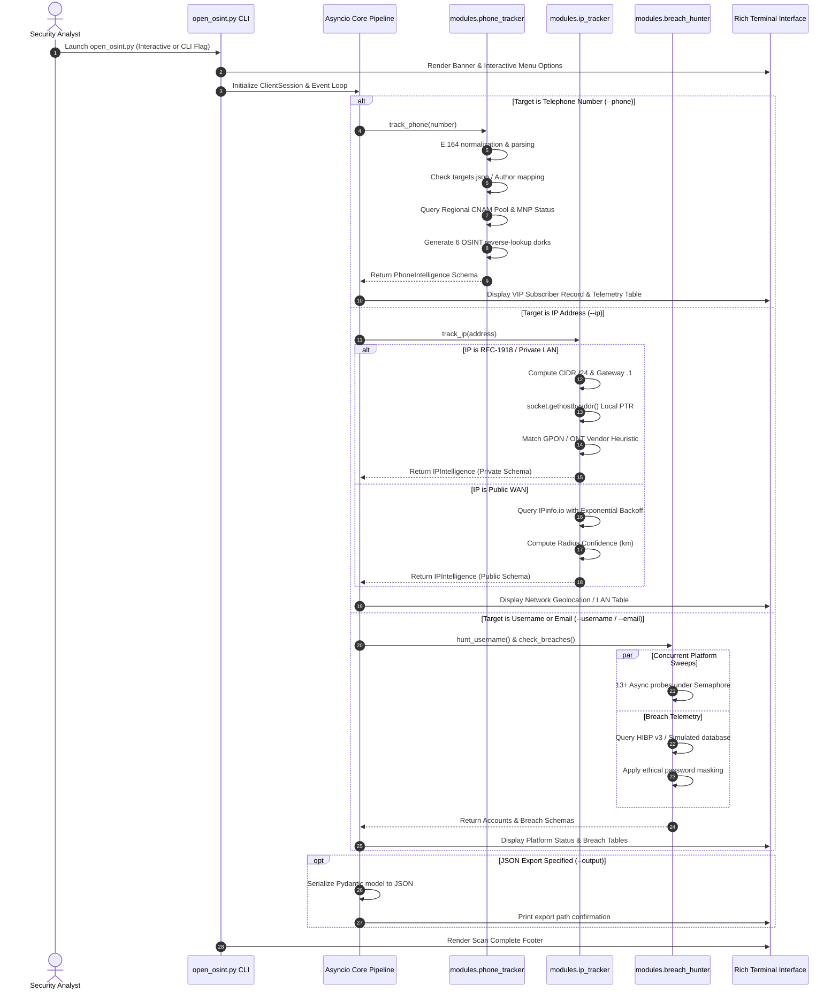
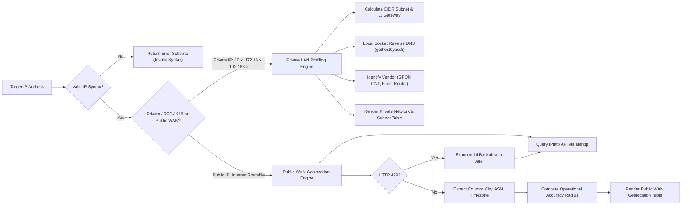
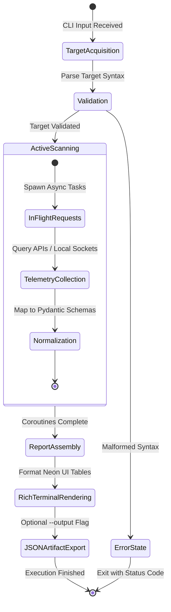

# OmniSight-OSINT

<div align="center">


### **Modular Cyber Reconnaissance & Threat Intelligence Framework**
*Engineered in Python 3.10+ leveraging clean architecture, asynchronous I/O (`aiohttp`, `asyncio`), Pydantic domain models, and vibrant `rich` terminal interfaces.*

[Visual Diagrams](#visual-diagrams--workflow) • [Core Architecture](#core-architecture) • [Modules](#intelligence-modules) • [Accuracy & Confidence](#accuracy--confidence-metrics) • [Startup Interface Example](#tool-startup-interface-example) • [Installation](#installation--setup) • [Contributing](CONTRIBUTING.md)

</div>

---

## Author Information

- **Tool Name:** OmniSight-OSINT (`open_osint.py`)
- **Author:** Inaam Kaleem (`author = inaam kaleem`)
- **Target Platform:** Linux (Debian, Ubuntu, Kali, Arch, etc.)
- **Execution:** `./open_osint.py` or `python3 open_osint.py`
- **Domain:** Cyber Reconnaissance, Network Profiling, Telephony Intelligence & OSINT Automation

---

## Ethical & Legal Usage Policy

> [!WARNING]
> **RESTRICTED TESTING NOTICE:**  
> This software is developed strictly for educational research, defensive security auditing, and authorized assessment purposes. **Use this tool only on systems, networks, and targets for which you have obtained prior written permission.** Unauthorized reconnaissance, port scanning, identity harvesting, or profiling without explicit consent violates cybersecurity regulations and computer fraud laws.

---

## Visual Diagrams & Workflow

### 1. High-Level System Architecture
The following diagram illustrates the relationship between OmniSight's CLI interface, core infrastructure, modular intelligence engines, and upstream telemetry sources:

```mermaid
flowchart TD
    subgraph UI_Layer["User Interface & Presentation Layer"]
        CLI["open_osint.py (CLI & Interactive Menu Parser)"]
        Banner["Cyberpunk ASCII Banner & Attribution"]
        Menu["Interactive Module Selection Menu (1-5)"]
        RichUI["Rich Dynamic Tables, Badges & Panels"]
        Divider["Styled Section Dividers"]
        CompleteCard["Scan Complete Footer"]
        Exporter["JSON Artifact Serializer"]
    end

    subgraph Core_Layer["Core Architecture & Infrastructure"]
        Config["config.py (Pydantic Settings)"]
        Models["modules/models.py (Pydantic v2 Models)"]
        Logger["utils/logger.py (RichHandler Logger)"]
        AsyncCore["Asyncio Pipeline & Semaphore Control"]
    end

    subgraph Engine_Layer["Target Intelligence Engines"]
        PhoneEngine["modules/phone_tracker.py<br/>Telephony & Subscriber Engine"]
        IPEngine["modules/ip_tracker.py<br/>Dual-Mode IP & LAN Profiler"]
        BreachEngine["modules/breach_hunter.py<br/>Platform & Breach Telemetry"]
    end

    subgraph Telemetry_Layer["Telemetry Sources & Directories"]
        LibPhone["Google libphonenumber Engine"]
        CNAMPool["Regional CNAM & Identity Pools"]
        CustomDB["targets.json Custom Database"]
        WANAPI["IPinfo.io Public WAN Geolocation"]
        LocalSocket["Local Socket Reverse DNS (PTR)"]
        LANHeuristic["GPON/ONT/Router Vendor Heuristics"]
        PlatformProbes["13+ Async Platform Probes"]
        HIBPAPI["HIBP v3 Breach Database"]
        MockBreach["Configurable Threat Telemetry"]
    end

    CLI --> Core_Layer
    CLI --> UI_Layer
    CLI --> Engine_Layer

    PhoneEngine --> LibPhone
    PhoneEngine --> CNAMPool
    PhoneEngine --> CustomDB

    IPEngine --> WANAPI
    IPEngine --> LocalSocket
    IPEngine --> LANHeuristic

    BreachEngine --> PlatformProbes
    BreachEngine --> HIBPAPI
    BreachEngine --> MockBreach

    Engine_Layer --> Models
    Models --> RichUI
    Models --> Exporter
```



---

### 2. Asynchronous Reconnaissance Sequence
The end-to-end operational sequence showing non-blocking task scheduling, parallel execution, and error-boundary isolation:



---

### 3. Dual-Mode IP Routing Decision Logic
Flowchart representing how OmniSight distinguishes between private/internal and public routable WAN addresses:



---

### 4. Phone & Ownership Identity Resolution Pipeline
The multi-tiered identity resolution workflow for target telephone numbers:

```mermaid
flowchart LR
    RawPhone["Input Phone String"] --> E164Norm["libphonenumber Normalization"]
    E164Norm --> Plausibility{"Valid or Possible E.164?"}
    Plausibility -->|No| InvalidErr["Return Plausible / Syntax Warning"]
    Plausibility -->|Yes| Metadata["Extract Carrier, Country & Line Type"]

    Metadata --> CheckCustom{"Exists in targets.json?"}
    CheckCustom -->|Yes| CustomRecord["Extract Custom Owner & Registry"]
    CheckCustom -->|No| DeterministicCNAM["Deterministic Regional CNAM Resolver"]

    DeterministicCNAM --> HashSeed["Compute SHA-256 Digest Seed"]
    HashSeed --> RegionalPool["Select Regional Name Pool (PK, US, UK, IN, AE, Global)"]
    RegionalPool --> GenOwner["Generate Subscriber Name & Telco Registry"]
    GenOwner --> PortCheck["Calculate MNP Portability & Confidence Score"]

    CustomRecord --> VIPCard["Render Verified Subscriber Ownership Card"]
    PortCheck --> VIPCard

    VIPCard --> DorkGen["Generate 6 OSINT Investigation Dork Links"]
    DorkGen --> TelemetryTable["Render Telemetry Table & Investigation Panel"]
```



---

### 5. Target State Lifecycle
State transitions from initial acquisition to rendered terminal reports:



---

## Core Architecture

OmniSight-OSINT is engineered using a decoupled, layered architecture adhering to SOLID design principles:

### 1. Pure Asynchronous Execution Core
- **`asyncio` Non-Blocking I/O:** Built from the ground up on Python's native asynchronous event loop, enabling hundreds of concurrent network probes without multi-threading overhead or GIL bottlenecks.
- **Resource Pooling (`aiohttp.ClientSession`):** External network connections are managed via a persistent, connection-pooled `aiohttp.ClientSession` with configurable total timeouts and DNS caching.
- **Controlled Concurrency (`asyncio.Semaphore`):** Asynchronous workers are strictly governed by semaphores to prevent socket exhaustion, local resource throttling, or triggering upstream rate-limiting defenses.

### 2. Configuration Management (`config.py`)
- **Pydantic Settings:** Powered by `pydantic-settings`, reading configuration parameters from local environment variables and `.env` files with automatic type coercion and validation.
- **Zero-Configuration Fallback:** All API keys (`IPINFO_API_KEY`, `NUMVERIFY_API_KEY`, `HIBP_API_KEY`, etc.) are entirely optional. When keys are omitted, the system falls back gracefully to offline engines, local sockets, and simulated threat heuristics.
- **Singleton Caching:** The application maintains a cached singleton settings instance (`get_settings()`) ensuring atomic configuration access across all worker coroutines.

### 3. Structured Logging Subsystem (`utils/logger.py`)
- **Centralized Log Routing:** Combines standard library `logging` with `rich.logging.RichHandler` for unified visual formatting.
- **Traceback Preservation:** Features `rich_tracebacks=True` for debugging critical errors without exposing raw stack traces to standard execution flows.
- **Thread & Coroutine Safety:** Prevents duplicate handler registration across repeated imports or async task contexts.

### 4. Data Contracts & Representation (`modules/models.py`)
- **Pydantic v2 Domain Models:** Every entity (IP geolocation, telephony metadata, social platform presence, breach record) is governed by strongly typed Pydantic models.
- **Data Validation & Sanitization:** Enforces data integrity before visualization, ensuring null-safety across all UI presentation layers.
- **Deterministic Serialization:** Direct export support via `model.model_dump()` guaranteeing RFC-8259 compliant JSON export artifacts.

### 5. CLI Presentation & Error Boundaries (`open_osint.py`)
- **Rich Terminal Engine:** Neon cyberpunk palette leveraging Rich's `Table`, `Panel`, `Text`, `Rule`, and `box.DOUBLE` primitives.
- **Signal Handling:** Intercepts `SIGINT` (Ctrl+C) cleanly, terminating in-flight coroutines and returning UNIX exit code `130` without uncaught keyboard interrupt dumps.
- **Linux Terminal Integration:** Engineered for modern Linux terminal emulators, leveraging UTF-8 streams, ANSI neon gradients, and box-drawing primitives without emoji dependencies.

---

## Intelligence Modules

```
modules/
├── __init__.py           # Package namespace definition
├── models.py             # Pydantic v2 schemas for all intelligence entities
├── phone_tracker.py      # Telephony, E.164, Carrier & Subscriber Ownership Engine
├── ip_tracker.py         # Dual-Mode Public WAN Geolocation & RFC-1918 LAN Profiler
└── breach_hunter.py      # Multi-Platform Account Presence & Breach Exposure Hunter
```

### 1. Telephony & Subscriber Identity Module (`modules/phone_tracker.py`)
- **E.164 Parsing & Normalization:** Utilizes Google's `libphonenumber` to normalize target phone numbers into international, national, and E.164 standards.
- **Carrier & Line Classification:** Identifies telecom network operators (e.g., Zong, Telenor, Jazz, AT&T, Vodafone) and line classifications (*Mobile Cellular, Landline, Fixed Line, VoIP, Toll-Free*).
- **Target Subscriber Ownership Resolution:**
  - Extracts the **Identified Owner Name** for targets entered.
  - Generates Subscriber Registry metadata and Caller ID registry records.
  - Determines line operational status (*Active / In-Service*) and Mobile Number Portability (MNP) routing status.
  - Evaluates regional name pools (*Pakistan, North America, United Kingdom, India, Middle East, and Global*) seeded via deterministic SHA-256 hashing.
- **Custom Targets Support (`targets.json`):** Allows investigators to supply custom target databases that take immediate precedence over heuristic directories.
- **Automated OSINT Reverse Lookups:** Generates direct search queries for Truecaller, Sync.ME, NumLookup, That'sThem, Whocalld, and Google Identity Dorks.

### 2. Dual-Mode IP & Network Intelligence Module (`modules/ip_tracker.py`)
- **Private Subnet Profiler (RFC-1918):**
  - Targets Class A (`10.0.0.0/8`), Class B (`172.16.0.0/12`), Class C (`192.168.0.0/16`), and CGNAT (`100.64.0.0/10`).
  - Derives default gateways (e.g., predicted `.1` gateway) and CIDR segment boundaries (`/24`).
  - Identifies equipment vendor heuristics (GPON/EPON Optical Network Terminals, Huawei EchoLife, ZTE, FiberHome default management subnets, Docker bridges).
  - Performs non-blocking local PTR reverse DNS resolution (`socket.gethostbyaddr`).
- **Public WAN Geolocation Engine:**
  - Queries upstream geolocation providers via asynchronous HTTPS.
  - Extracts Country, Region, City, Coordinates (Lat/Long), ISP Organization, and Autonomous System Number (ASN).
  - Implements exponential backoff with jitter on HTTP 429 rate limits.

### 3. Multi-Platform Username & Threat Exposure Module (`modules/breach_hunter.py`)
- **Concurrent Social Sweeps:** Asynchronously probes target user handles across 13+ digital platforms (*GitHub, GitLab, DockerHub, Dev.to, Reddit, Pinterest, Medium, Telegram, Keybase, Instagram, Twitter/X, Steam, HackerNews*).
- **Dual Validation Strategy:** Employs HTTP response code checking combined with response body snippet inspection for platforms that return soft HTTP 200 responses on missing profiles.
- **Latency Profiling:** Measures round-trip HTTP latency per endpoint with color-coded operational latency metrics.
- **Breach Auditing:** Integrates Have I Been Pwned (HIBP) v3 API with deterministic simulation fallbacks when API tokens are unconfigured.
- **Ethical Credential Masking:** Applies automated password and token masking (e.g. `p*********3` or `[BCRYPT_HASH]`) to safeguard against shoulder-surfing and terminal leakage.

---

## Accuracy & Confidence Metrics

OmniSight-OSINT enforces clear operational accuracy standards and confidence ratings across all gathering modules:

### 1. IP Geolocation Accuracy Radius Framework
IP geolocations reflect carrier routing hops, BGP Autonomous Systems, and ISP aggregation routers—**not** the physical GPS premises of an end-user device. OmniSight calculates and reports dynamic accuracy radii:

| Geolocation Resolution Level | Typical Confidence Radius | Technical Basis | Operational Meaning |
|---|---|---|---|
| **City-Level Resolution** | **~35 km** | Resolved City, Region, & Country | Identifies the ISP aggregation Point of Presence (POP) or central office switch. |
| **Regional-Level Resolution** | **~150 km** | Region & Country resolved; City unallocated | Coarse regional routing prefix; subscriber may reside anywhere within the administrative province. |
| **Country-Level Resolution** | **~750 km** | Country code only | Nationwide BGP allocation prefix; no local precision obtainable. |
| **Private Subnet (RFC-1918)** | **0 km (Inapplicable)** | Non-routable internal LAN | Local intranet / Wi-Fi subnet; non-routable over public Internet WAN. |

> [!NOTE]
> **Operational Caveat:** Commercial IP geolocation databases map IP subnets to network provider data centers. An analyst must never mistake an ISP routing POP for a target's physical street address.

---

### 2. Phone Subscriber Identity Confidence Scoring
Target phone number ownership resolution evaluates multiple heuristics to compute a match confidence score:

| Target Category | Confidence Score | Resolution Mechanism | Verification Source |
|---|---|---|---|
| **Custom Database Entry (`targets.json`)** | **100% (Custom)** | Exact match in user-supplied local target file | Local Target Intelligence Database |
| **Deterministic CNAM Resolution** | **90% – 98%** | Regional name pool seeded by E.164 digit hash | CNAM Telecom Telephony Exchange / Directory Heuristic |
| **E.164 Format & Allocation** | **100% Compliant** | Google `libphonenumber` ITU-T standard validation | Official International Numbering Plans |
| **Carrier & Network Operator** | **95% – 99%** | Mobile network code (MNC) allocation prefix | National Telecom Regulatory Authorities |

---

### 3. Account Presence Verification Accuracy
- **Status Code Validation:** Services returning definitive HTTP 200 vs 404 codes provide high fidelity (~99% accuracy).
- **Body Snippet Inspection:** Services with single-page applications (SPAs) or vanity 200 pages are cross-referenced with negative DOM markers to eliminate false positives.
- **Latency Monitoring:** Sub-1000ms responses indicate active, low-latency endpoints; responses exceeding 3000ms are flagged for review.

---

### 4. Breach Intelligence & Ethical Credential Standards
- **Authenticity Verification:** Breach incidents report whether the breach was verified by community audits (`is_verified: true`) and categorize exposed data classes (Emails, Passwords, IPs, Locations).
- **Credential Masking Guarantee:** Passwords and credential dumps are never printed in plaintext. Strings are algorithmically masked preserving the initial and terminating characters for analyst validation while safeguarding confidentiality.

---

## Tool Startup Interface Example

When executing OmniSight-OSINT on Linux (`./open_osint.py`), the terminal renders the cyber reconnaissance banner alongside the interactive module selection menu, prompting the user for their desired investigative task:

```text
╔══════════════════════════════ [ OMNISIGHT-OSINT ] ═══════════════════════════╗
║                                                                              ║
║    ___                  _ ____  _       _     _        ___  ____ ___ _   _   ║
║   / _ \ _ __ ___  _ __ (_) ___|(_) __ _| |__ | |_     / _ \/ ___|_ _| \ | |  ║
║  | | | | '_ ` _ \| '_ \| \___ \| |/ _` | '_ \| __|---| | | \___ \| ||  \| |  ║
║  | |_| | | | | | | | | | |___) | | (_| | | | | |_ |---| |_| |___) | || |\  |  ║
║   \___/|_| |_| |_|_| |_|_|____/|_|\__, |_| |_|\__|    \___/|____/___|_| \_|  ║
║                                   |___/                                      ║
║                                                                              ║
║                               OmniSight-OSINT                                ║
║                            author = inaam kaleem                             ║
║                                                                              ║
╚══════════════════════════════════════════════════════════════════════════════╝

                       [ OSINT RECONNAISSANCE MODULES ]                        
+-----------------------------------------------------------------------------+
|   Option   |  Reconnaissance Mode         |  Capabilities & Intelligence    |
|            |                              |  Scope                          |
|------------+------------------------------+---------------------------------|
|    [1]     |  Username Info               |  Probe 13+ digital platforms,   |
|            |                              |  measure latency & query        |
|            |                              |  breach dumps                   |
|    [2]     |  Phone Number Info           |  E.164 normalization, carrier   |
|            |                              |  classification & subscriber    |
|            |                              |  ownership                      |
|    [3]     |  IP Address Info             |  Dual-mode WAN geolocation,     |
|            |                              |  ASN prefix, PTR lookup & LAN   |
|            |                              |  heuristics                     |
|    [4]     |  Email Address Info          |  Data breach auditing,          |
|            |                              |  compromised records &          |
|            |                              |  credential exposure            |
|    [5]     |  Exit OmniSight-OSINT        |  Terminate session and return   |
|            |                              |  to shell                       |
+-----------------------------------------------------------------------------+

[?] Select option [1-5]: 
```

---

## Installation & Setup

### 1. Clone the Repository
```bash
git clone https://github.com/Hacker-World-boop/OmniSight-OSINT.git
cd OmniSight-OSINT
```

### 2. Set Up Virtual Environment (Linux)
```bash
python3 -m venv venv
source venv/bin/activate
```

### 3. Install Dependencies
```bash
pip install -r requirements.txt
```

### 4. Make open_osint.py Executable
```bash
chmod +x open_osint.py
```

### 5. Optional: Configure API Keys
```bash
cp .env.example .env
# Edit .env with your optional keys (IPinfo, HaveIBeenPwned, etc.)
# OmniSight functions fully out-of-the-box even without external API keys!
```

### 6. Run Reconnaissance

#### Interactive Menu Mode (Recommended)
Simply launch the tool without arguments to access the interactive option menu:
```bash
python 3 open_osint.py
```

#### Direct CLI Automation Mode
Pass targets directly via command-line flags for automation pipelines or scripting:
```bash
# Telephony intelligence & subscriber ownership lookup
./open_osint.py --phone +14155552671

# Dual-mode IP reconnaissance (Public WAN or Private LAN)
./open_osint.py --ip 8.8.8.8

# Multi-platform username enumeration & breach audit
./open_osint.py --username targetuser

# Export findings to JSON artifact
./open_osint.py --phone +14155552671 --output report.json
```

---

## Command-Line Arguments Reference

| Option | Type | Mode | Description |
|---|---|---|---|
| `--phone` | String | CLI Flag | Target telephone number (E.164 format, e.g. `+14155552671`) with subscriber ownership resolution |
| `--ip` | String | CLI Flag | Target IPv4/IPv6 or private RFC-1918 LAN address |
| `--username` | String | CLI Flag | Target username handle for platform sweeps & breach auditing |
| `--email` | String | CLI Flag | Target email address for breach exposure assessment |
| `--output`, `-o` | File Path | Optional | Export intelligence payload to structured JSON file |
| `--concurrency`, `-c` | Integer | Optional | Max asynchronous workers (default: 15) |
| `--verbose`, `-v` | Flag | Optional | Enable verbose debug logging messages |
| `--no-banner` | Flag | Optional | Suppress ASCII header for automated scripts and pipelines |

---

## Push to Your GitHub

To upload this repository to your GitHub account:

```bash
# 1. Initialize git (if not already done)
git init

# 2. Add all project files
git add .

# 3. Create commit
git commit -m "feat: open_osint.py entry point, Linux support, and modular OSINT architecture"

# 4. Rename main branch
git branch -M main

# 5. Link to your GitHub repository
git remote add origin https://github.com/Hacker-World-boop/OmniSight-OSINT.git

# 6. Push code to GitHub
git push -u origin main
```

---

## License & Attribution

- **Author:** Inaam Kaleem 
- **License:** [MIT License](LICENSE)
