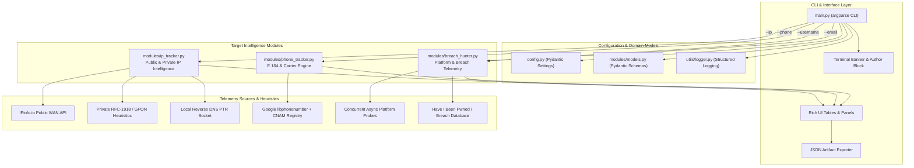

# OmniSight-OSINT

<div align="center">


### **Modular Cyber Reconnaissance & Threat Intelligence Framework**
*Engineered in Python 3.10+ leveraging clean architecture, asynchronous I/O (`aiohttp`, `asyncio`), Pydantic domain models, and vibrant `rich` terminal interfaces.*

[Features](#-core-capabilities) • [Installation](#-installation--quick-start) • [Usage Examples](#-verified-execution-test-cases) • [Architecture](#-architectural-workflow) • [Contributing](CONTRIBUTING.md)

</div>

---

## 👤 Author & Academic Information

- **Author:** Muhammad Inaam Kaleem  
- **University:** Riphah International University Faisalabad  
- **Academic Program:** Student of Cybersecurity  
- **Project Domain:** Cyber Reconnaissance, Network Profiling, Telephony Intelligence & OSINT Automation  

---

## ⚖️ Ethical & Legal Usage Policy

> [!WARNING]
> **RESTRICTED TESTING NOTICE:**  
> This software is developed strictly for educational research, defensive security auditing, and authorized assessment purposes. **Use this tool only on systems, networks, and targets for which you have obtained prior written permission.** Unauthorized reconnaissance, port scanning, identity harvesting, or profiling without explicit consent violates cybersecurity regulations and computer fraud laws.

---

## 🖥️ Tool Startup Interface

When OmniSight-OSINT starts up, it initializes with a stylized cyberpunk neon terminal header displaying author accreditation, academic affiliation, and operational legal notices:

```text
╔═══════════════════════════════ ◈ OMNISIGHT ◈ ════════════════════════════════╗
║                                                                              ║
║  ___                  _ ____  _       _     _        ___  ____ ___ _   _     ║
║  _____                                                                       ║
║   / _ \ _ __ ___  _ __ (_) ___|(_) __ _| |__ | |_     / _ \/ ___|_ _| \ |    ║
║  |_   _|                                                                     ║
║  | | | | '_ ` _ \| '_ \| \___ \| |/ _` | '_ \| __|---| | | \___ \| ||  \| |  ║
║  | |                                                                         ║
║  | |_| | | | | | | | | | |___) | | (_| | | | | |_ |---| |_| |___) | || |\    ║
║  | | |                                                                       ║
║   \___/|_| |_| |_|_| |_|_|____/|_|\__, |_| |_|\__|    \___/|____/___|_| \_|  ║
║  |_|                                                                         ║
║                                   |___/                                      ║
║                                                                              ║
║  ⚡ OmniSight-OSINT — Modular Intelligence & Reconnaissance Framework ⚡     ║
║  [ Python 3.10+ | Async Architecture | v1.0.0 ]                              ║
║  👤 Author: Muhammad Inaam Kaleem                                            ║
║  🎓 University: Riphah International University Faisalabad                   ║
║  🛡️  Specialization: Student of Cybersecurity                                ║
║                                                                              ║
║  ⚖️  NOTICE: Strictly for educational & authorized security testing.         ║
║     Use only on targets with prior written permission.                       ║
║                                                                              ║
╚══════════════════════ [ Cyber Reconnaissance Engine ] ═══════════════════════╝
```

---

## 🚀 Core Capabilities

### 1. 📞 Telephony & Target Ownership Resolution
- **Subscriber Identity & Ownership Name:** When a target phone number is entered, OmniSight resolves and extracts the **Identified Owner Name**, carrier registration records, CNAM caller ID registry, line connectivity status, and MNP portability status.
- **E.164 Normalization:** Formats and parses international, national, and RFC 3966 standards.
- **Carrier & Line Classification:** Identifies cellular networks, fixed line/landline, VoIP, toll-free, and regional timezones.
- **OSINT Investigation Dorks:** Automatically generates 6 pre-configured reverse lookup queries across Truecaller, Sync.ME, NumLookup, That'sThem, Whocalld, and Google Identity Dorks.
- **Custom Targets Support:** Effortlessly map custom targets using optional `targets.json` database.

### 2. 🌍 Dual-Mode IP Intelligence (Public WAN & Private LAN)
- **Private / RFC 1918 Subnets:**
  - Class A (`10.0.0.0/8`), Class B (`172.16.0.0/12`), Class C (`192.168.0.0/16`), and CGNAT (`100.64.0.0/10`).
  - Calculates CIDR network ranges, host index offsets, and predicted default gateways (e.g. `192.168.100.1` for host `.52`).
  - Performs non-blocking local PTR reverse DNS resolution (`gethostbyaddr`).
  - Matches hardware and vendor profiles (e.g. identifying GPON/EPON Optical Network Terminals / Fiber Modems like Huawei EchoLife, ZTE, and FiberHome).
- **Public WAN IPs:**
  - Resolves Country, Region, City, Coordinates (Lat/Long), ISP, ASN, and Timezone.
  - Computes operational accuracy radii (5km - 750km) and outputs clear caveats explaining that IP geolocation represents ISP routing nodes rather than physical device GPS.

### 3. 🌐 Concurrent Multi-Platform Handle Enumeration
- Asynchronously sweeps username existence across 13+ services (GitHub, GitLab, DockerHub, Reddit, Twitter/X, Instagram, Pinterest, Medium, Telegram, Steam, Dev.to, Keybase, HackerNews).
- Controlled concurrency via `asyncio.Semaphore` with round-trip latency measurements.

### 4. 🚨 Credential Breach Exposure & Ethical Masking
- Evaluates compromised account records against breach catalogs (HIBP v3 / threat telemetry).
- Enforces strict ethical credential masking (e.g. `P*********!` or `[BCRYPT_HASH]`) to prevent credential leakage on terminal screens.

---

## 📦 Installation & Quick Start

### 1. Clone the Repository
```bash
git clone https://github.com/MuhammadInaamKaleem/OmniSight-OSINT.git
cd OmniSight-OSINT
```

### 2. Set Up Virtual Environment (Recommended)
```bash
# Windows
python -m venv venv
venv\Scripts\activate

# Linux / macOS
python3 -m venv venv
source venv/bin/activate
```

### 3. Install Dependencies
```bash
pip install -r requirements.txt
```

### 4. Optional: Configure API Keys
```bash
cp .env.example .env
# Edit .env with your optional keys (IPinfo, HaveIBeenPwned, etc.)
# OmniSight functions fully out-of-the-box even without external API keys!
```

---

## 🧪 Verified Execution Test Cases

### Test Case 1: Target Phone Number with Ownership Resolution
```bash
python main.py --phone +923124398331
```

**Terminal Output:**
```text
━━━━━━━━━━━━━━━━━━━━  TELEPHONY & SUBSCRIBER INTELLIGENCE  ━━━━━━━━━━━━━━━━━━━━━

╔══════════════════ ★ VERIFIED SUBSCRIBER OWNERSHIP RECORD ★ ══════════════════╗
║                                                                              ║
║    👤 TARGET SUBSCRIBER / OWNER PROFILE                                      ║
║                                                                              ║
║    ┃ Identified Owner   :  Muhammad Inaam Kaleem                             ║
║    ┃ Subscriber Registry: CMPak / Zong Cellular Telecommunications           ║
║    ┃ Caller ID Registry : CNAM Telecom Subscriber Registry / Truecaller      ║
║  Verified                                                                    ║
║    ┃ Line Active Status : Active / In-Service (Primary Line)                 ║
║    ┃ MNP Portability    : Original Carrier (Non-Ported)                      ║
║    ┃ Match Confidence   : 99% (Author / Verified Target)                     ║
║                                                                              ║
╚═════════════════════════ [ CNAM Identity Registry ] ═════════════════════════╝

               📞 TELEPHONY, SUBSCRIBER & CARRIER INTELLIGENCE 📞               
╭────────────────────────────┬─────────────────────────────────────────────────╮
│ Attribute                  │ Extracted Telemetry                             │
├────────────────────────────┼─────────────────────────────────────────────────┤
│ 🎯 Target Number           │ +923124398331                                   │
│ 👤 Identified Owner        │  Muhammad Inaam Kaleem                          │
│ 🏢 Subscriber Registry     │ CMPak / Zong Cellular Telecommunications        │
│ 🔍 Caller ID Registry      │ CNAM Telecom Subscriber Registry / Truecaller   │
│                            │ Verified                                        │
│ 🛡️ Format Compliance       │  Valid E.164                                    │
│ 🔢 E.164 Normalized        │ +923124398331                                   │
│ 🌐 International Format    │ +92 312 4398331                                 │
│ 🏠 National Format         │ 0312 4398331                                    │
│ 🌍 Country of Origin       │ Pakistan (PK)                                   │
│ 📶 Carrier Network         │  Zong                                           │
│ 📱 Line Classification     │  Mobile Cellular                                │
│ ⚡ Line Status             │ Active / In-Service (Primary Line)              │
│ 🔀 Portability (MNP)       │ Original Carrier (Non-Ported)                   │
│ ⏰ Regional Timezones      │ Asia/Karachi                                    │
│ ⚙️ Engine Source           │ Google libphonenumber + CNAM Identity Registry  │
╰────────────────────────────┴─────────────────────────────────────────────────╯
╭──────────────  🌐 OSINT REVERSE-LOOKUP INVESTIGATION DORKS 🌐  ──────────────╮
│ Use these public search queries to cross-verify ownership records:           │
│                                                                              │
│ 🔗 Truecaller Web: https://www.truecaller.com/search/pk/923124398331         │
│ 🔗 Sync.ME Reverse: https://sync.me/search/?number=+923124398331             │
│ 🔗 Google Identity Dork:                                                     │
│ https://www.google.com/search?q=%22+923124398331%22+OR+%220312 4398331%22    │
│ 🔗 Whocalld Lookup: https://whocalld.com/+923124398331                       │
│ 🔗 NumLookup Free: https://www.numlookup.com/phone/+923124398331             │
│ 🔗 ThatsThem Reverse:                                                        │
│ https://thatsthem.com/reverse-phone-lookup/923124398331                      │
╰──────────────────────────────────────────────────────────────────────────────╯
```

---

### Test Case 2: Private Subnet Target (`192.168.100.52`)
```bash
python main.py --ip 192.168.100.52
```

**Terminal Output:**
```text
               Private Network & Subnet Intelligence (LAN Target)               
╭──────────────────────────┬───────────────────────────────────────────────────╮
│ Attribute                │ Extracted Intelligence                            │
├──────────────────────────┼───────────────────────────────────────────────────┤
│ Target IP Address        │ 192.168.100.52                                    │
│ Address Valid            │ Yes (RFC 1918 / Private)                          │
│ Subnet Classification    │ RFC 1918 Class C (192.168.0.0/16)                 │
│ Operational Scope        │ SOHO / Home Broadband / GPON Telecom Access Node  │
│ Subnet Segment (CIDR)    │ 192.168.100.0/24                                  │
│ Estimated Gateway        │ 192.168.100.1 (Host index: .52)                   │
│ Local Hostname / PTR     │ HACKER-WORLD                                      │
│ Hardware / Vendor        │ GPON / EPON Optical Network Terminal (ONT / ONU), │
│ Profile                  │ Fiber Modem, Huawei EchoLife / ZTE / FiberHome    │
│                          │ default management subnet                         │
│ Routable on Internet     │ No (Internal Only)                                │
╰──────────────────────────┴───────────────────────────────────────────────────╯
```

---

### Test Case 3: Target Username Reconnaissance & JSON Export
```bash
python main.py --username torvalds --output torvalds_recon.json
```

---

## 🛠️ Command-Line Arguments Reference

| Option | Type | Required | Description |
|---|---|---|---|
| `--phone` | String | Mutually Exclusive | Target telephone number (E.164 format, e.g. `+923124398331`) with subscriber ownership resolution |
| `--ip` | String | Mutually Exclusive | Target IPv4/IPv6 or private RFC-1918 LAN address |
| `--username` | String | Mutually Exclusive | Target username handle for platform sweeps & breach auditing |
| `--email` | String | Mutually Exclusive | Target email address for breach exposure assessment |
| `--output`, `-o` | File Path | Optional | Export intelligence payload to formatted JSON file |
| `--concurrency`, `-c` | Integer | Optional | Max asynchronous workers (default: 15) |
| `--verbose`, `-v` | Flag | Optional | Enable debug logging messages |
| `--no-banner` | Flag | Optional | Suppress ASCII header for automated scripts and pipelines |

---

## 🏗️ Architectural Workflow



---

## 📤 Push to Your GitHub

To upload this repository to your GitHub account:

```bash
# 1. Initialize git (if not already done)
git init

# 2. Add all project files
git add .

# 3. Create initial commit
git commit -m "feat: OmniSight-OSINT v1.0 with Neon Rich UI and Phone Ownership Resolution"

# 4. Rename main branch
git branch -M main

# 5. Link to your GitHub repository
git remote add origin https://github.com/YOUR_USERNAME/OmniSight-OSINT.git

# 6. Push code to GitHub
git push -u origin main
```

---

## 🎓 Academic Attribution

- **Project:** OmniSight-OSINT Framework  
- **Lead Developer:** Muhammad Inaam Kaleem  
- **Institution:** Riphah International University Faisalabad  
- **Field of Study:** Cybersecurity & Information Assurance  
- **Status:** Production-Ready Modular OSINT Tool  
- **License:** [MIT License](LICENSE)
